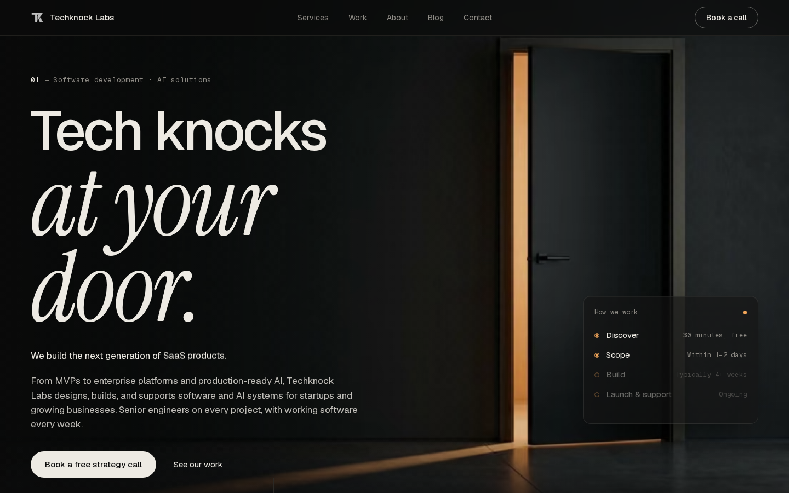
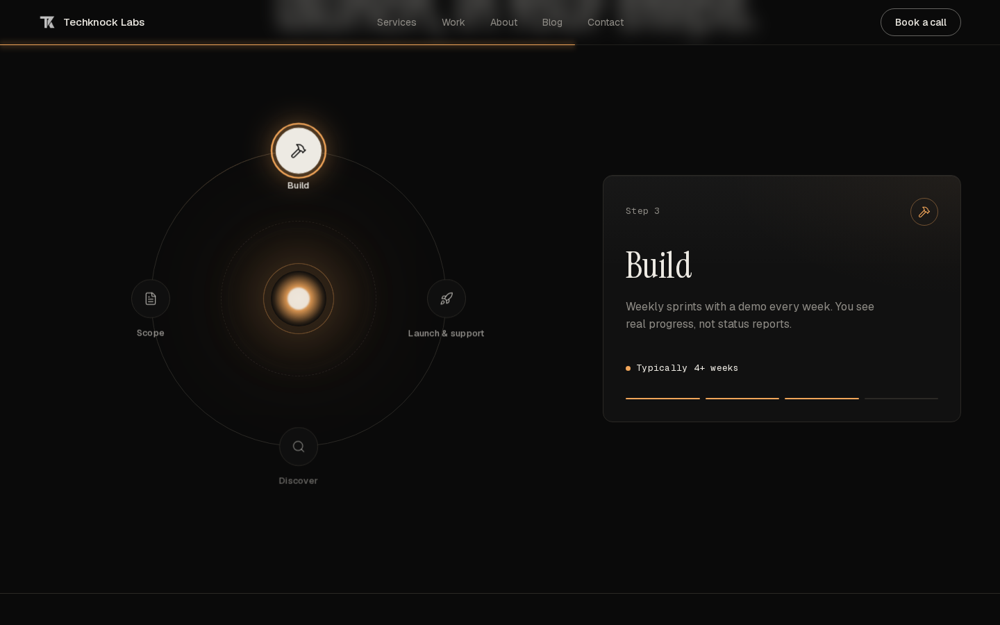
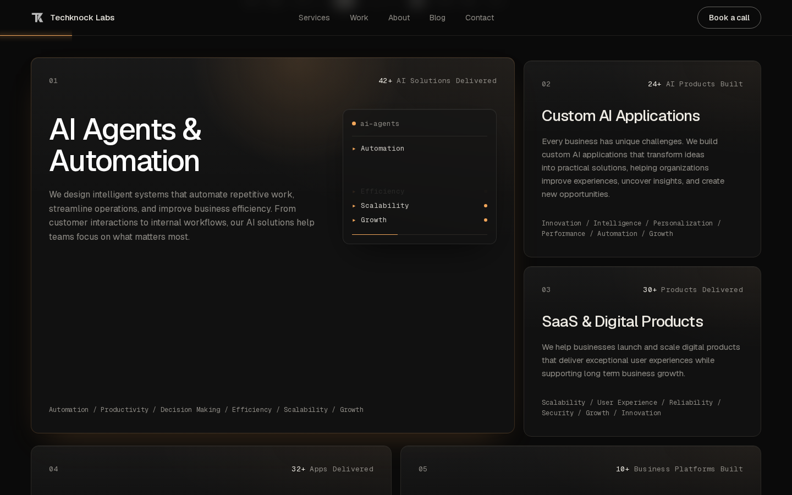
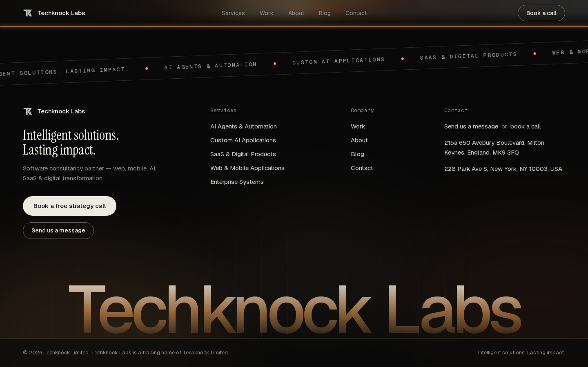
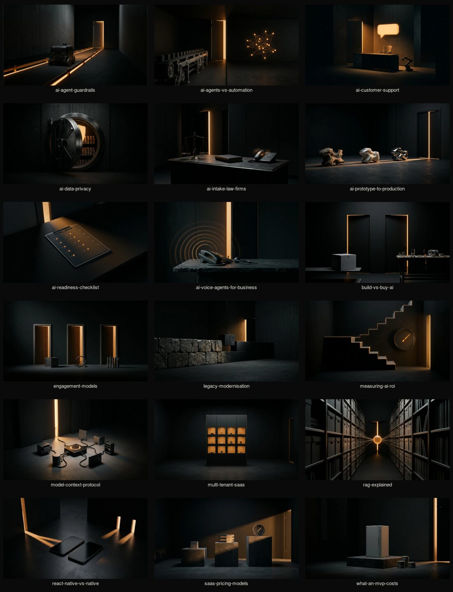

<div align="center">



# Techknock Labs — Redesign (concept: The Door Ajar)

A dark, light-led concept redesign of the Techknock Labs website: a near-black site where amber light is the only accent, built with Next.js 16 and Tailwind CSS v4.

**[techknocklabs.vercel.app →](https://techknocklabs.vercel.app/)**

[](https://nextjs.org/)
[](https://tailwindcss.com/)
[](https://www.typescriptlang.org/)
[](https://techknocklabs.vercel.app/)

</div>

> [!NOTE]
> This is an **unofficial concept redesign** of [techknocklabs.com](https://www.techknocklabs.com/). It is not affiliated with or endorsed by Techknock Limited. All text, services, case studies, testimonials and blog articles are the company's **official copy, used verbatim**; nothing was invented. Where the build departs from the brief or the live site, it is logged in [`DEVIATIONS.md`](DEVIATIONS.md).

---

## Features

- **Motion system.** One easing curve (`cubic-bezier(0.16, 1, 0.3, 1)`) everywhere; scroll reveals, split-word headings, staggered lists, count-ups and a hero line-mask choreography. Transform and opacity only, and every effect respects `prefers-reduced-motion`. Content stays visible without JavaScript.
- **Radial orbital timeline.** "How we work" is an orbit of the four official process steps around a glowing amber core. It rotates slowly, pauses on hover, and a click, focus or arrow key brings a step to the top and shows its official description. Below `lg` it falls back to a stacked list.
- **Spotlight cards.** The services bento and the "Why teams choose Techknock Labs" grid use a cursor-tracked amber border light, a soft inner gradient and a hover lift.
- **Container-scroll showcase.** The featured case study tilts in from 3D as you scroll (framer-motion), using the official work image and text.
- **Motion footer.** GSAP ScrollTrigger curtain reveal (lazy-loaded), drifting aurora glow, grid pattern, a diagonal marquee of the official service names, magnetic buttons and the company name as giant masked type.
- **Per-post blog covers.** Each of the 18 articles has its own generated "Door Ajar" cover (the official site has no blog images).
- **Smooth scroll that behaves.** Lenis on desktop pointers only. A nav click jumps to the top instantly so the new page animates on arrival; back/forward keeps the restored position.

<table>
  <tr>
    <td width="50%"></td>
    <td width="50%"></td>
  </tr>
  <tr>
    <td align="center"><sub>How we work: radial orbital timeline</sub></td>
    <td align="center"><sub>What we do: spotlight-card bento</sub></td>
  </tr>
  <tr>
    <td width="50%"></td>
    <td width="50%"></td>
  </tr>
  <tr>
    <td align="center"><sub>Motion footer</sub></td>
    <td align="center"><sub>Per-post blog covers</sub></td>
  </tr>
</table>

## Tech stack

| Area | Choice |
| --- | --- |
| Framework | [Next.js 16](https://nextjs.org/) (App Router), React 19 |
| Language | TypeScript |
| Styling | [Tailwind CSS v4](https://tailwindcss.com/) via PostCSS, CSS custom properties |
| Motion | CSS animations + IntersectionObserver, [framer-motion](https://motion.dev/), [GSAP](https://gsap.com/) ScrollTrigger |
| Scrolling | [Lenis](https://lenis.darkroom.engineering/) |
| Icons | [lucide-react](https://lucide.dev/) |
| Testing | [Playwright](https://playwright.dev/) scripts, ESLint |
| Hosting | [Vercel](https://vercel.com/) (auto-deploys `main`) |

## Project structure

```text
techknocklabs/
├── docs/
│   ├── IMAGE-PROMPT-LOG.md   # prompts behind every generated image
│   ├── VISUAL-BRIEF.md
│   └── readme/               # images used in this README
├── public/img/
│   ├── blog/<slug>.webp      # one generated cover per article
│   └── door-*.webp           # hero and CTA door imagery
├── scripts/                  # Playwright screenshot and verification scripts
├── src/
│   ├── app/                  # routes: /, /services, /work, /about, /blog, /contact
│   │   ├── services/[slug]/  # service detail pages
│   │   ├── work/[slug]/      # case studies
│   │   ├── blog/[slug]/      # articles
│   │   └── globals.css       # tokens, motion, component styles
│   ├── components/           # Nav, Footer, ProcessOrbit, ContainerScroll, Reveal, SmoothScroll, …
│   └── content/              # site.ts + services.json, work.json, blog.json (official copy)
├── DEVIATIONS.md
├── PLAN.md
└── Tracker.md
```

## Getting started

Requires Node.js 20 or newer.

```bash
npm ci            # install exact dependencies
npm run dev       # http://localhost:3000
npm run build     # production build
npm run lint      # ESLint
```

Optional checks against a production server (`npx next start -p 3100`):

```bash
node scripts/verify-nav-scroll.mjs   # nav click from page bottom → scrollY 0, reveals fire on arrival
node scripts/shots-ship2.mjs         # section screenshots → /tmp/shots
```

## Design tokens

| Token | Value | Use |
| --- | --- | --- |
| `--night` | `#0a0a0a` | Page background |
| `--surface` | `#141414` | Cards and panels |
| `--hairline` | `#2b2925` | Borders and dividers |
| `--muted` | `#8e8b85` | Secondary text |
| `--bone` | `#edeae3` | Primary text, primary buttons |
| `--amber` | `#f2a65a` | Light only: slits, glows, rings, focus, small accents |
| Sans | Geist | Body and headings |
| Mono | Geist Mono | Labels, tags, numbers |
| Serif | Instrument Serif | Display words and italic accents |
| `--ease-out` | `cubic-bezier(0.16, 1, 0.3, 1)` | All entrances and hovers |
| `--ease-in` | `cubic-bezier(0.7, 0, 0.84, 0)` | Exits |

## Credits

- **Content:** all copy, case studies, testimonials and articles belong to [Techknock Labs](https://www.techknocklabs.com/) (Techknock Limited).
- **Component inspiration from [21st.dev](https://21st.dev/)**, re-built in-house and re-skinned to this design (see [`DEVIATIONS.md`](DEVIATIONS.md) #17):
  - Radial Orbital Timeline by [@jatin-yadav05](https://21st.dev/@jatin-yadav05/components/radial-orbital-timeline)
  - Spotlight Card and Motion Footer by [@jahed](https://21st.dev/@jahed/components/spotlight-card)
  - Container Scroll Animation by [Aceternity UI / @manuarora700](https://21st.dev/@manuarora700/components/container-scroll-animation)
- **Imagery:** the door scenes and blog covers are AI-generated for this concept; the generation log (prompts and processing) is in [`docs/IMAGE-PROMPT-LOG.md`](docs/IMAGE-PROMPT-LOG.md). Case-study screenshots are Techknock's own.

## Further reading

- [`DEVIATIONS.md`](DEVIATIONS.md): every departure from the brief or the live site, and why
- [`docs/IMAGE-PROMPT-LOG.md`](docs/IMAGE-PROMPT-LOG.md): image generation log
